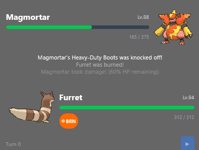

# Pokemon Battle Simulator

A fullstack application using Node.js for the backend with Smogon's open-source Pokemon Showdown engine to generate and simulate the battle and send line by line information to the frontend React application to display in a browser. 



## Features
- Simulates full Pokemon battles using Pokemon Showdown library
- Links with Streamerbot to allow twitch chat to bet points on the winner

## Tech Stack
- **Frontend:** React, TypeScript
- **Backend:** Node.js, Express

## Getting Started

### Prerequisites
- Node.js 20.6+

### Installation
```bash
git clone https://github.com/gdirk07/pokemon-battle-sim.git
cd pokemon-battle-sim
npm install
npm run dev
```
Then open http://localhost:<port> (located in frontend/vite.config.ts, default: 5173)
Note: on every run, scripts/sync-sprites.js is ran to download the sprites locally resulting in about ~322mb
of images and animations, a workaround is in progress for simply just trying it out.

## How It works

The system is a server-authorative model with an ack-gated loop. The backend is responsible for everything while the frontend is only
responsible for the overlay and telling the backend when it has finished showing so the backend can continue

`BattleFlow` is the state machine of the app phaces (`idle -> betting -> fighting -> victory -> back to idle`). It decides
when anything happens

`BattleSession` wraps Showdown outputs. It submits moves, turns Showdown's text protocol into log entries, and resolves a promise
when a turn is complete.

`Hub(socket.js)` the WebSocket server for the frontend.

`StreamerBotClient` the communication in the app for Streamerbot (down the road for other bots/applications). Contains a robust queue for messages

`useBattleSocket` renders what it's told and plays each turn at its own speed.

A turn is Triggered depending on how its ran. In dev (npm run dev), you click Next on the browser interface to progress turns, in prod (npm run start), Streamer.bot (or any other application in the future) sends `PB_NEXT_TURN`. Either way, `battleFlow.advance()` advances the turn.
`advance()` refuses if the state isn't `fighting` or if the previous turn hasn't finished being displayed in the frontend (hasn't received an ack yet). Will ignore any `PB_NEXT_TURN` that arrives too early.

As of now, `battle.playTurn()` picks a random move from each pokemon, writes them to the Showdown stream, and returns a promise.
Showdown's output is parsed line by line. `handleEvent` turns eahc line into a log entry that carries structured changes (`hp`, `status`, `substitute`) that go into a buffer. This buffer is released when the next `|turn|` line arrives (or |win|) and that resolves the promise. A turn is only complete when the following one starts.

`getState()` converts the raw log into readable text. Each entry gets formated into a more friendly output "Pikachu use Thunderbolt!"
"Volcarona took damage! (82% health remaining)

The frontend receives a `turn` message, the hook parses the states, merges the sprites it has and prepares to play the entries out.
It schedules one timer per entry at 1200ms intervals, when each entry fires it appends the text to the log and applies the entry's change so the HP bar move with that line
On the last entry it replaces the working state with the server's authoritative state (`finalizeTurn`) and sets isPlaying to false.
The frontend then sends an ack to signal to the backend that it has finishing showing the turn

When the backend receives the ack, it clears the watchdog and records this state as what is on screen
If the battle ended, switches to `victory`, broadcasts the phase change, and after that sends `PB_BATTLE_ENDED` to Streamer.bot (if prod) with the winner
If the battle has not ended, sends `PB_READY_FOR_NEXT_TURN` to Streamer.bot (and optionally schedules an auto-advance)
On the frontend, when the battle ends, the victory screen appears 3 seconds after the final entry plays out.

## Project Structure
```
backend/ The Express server and battle logic, as well as any communication with Streamer.bot
frontend/ React UI
shared/ Types shared by both front and backend
scripts/ Helper scripts, currently only one exists that sync's sprites and downloads them locally
util/ unused feature right now, but counts the number of total pokemon that existed upon a generation's release

## Credits
Battle logic powered by [Pokémon Showdown](https://github.com/smogon/pokemon-showdown).
Pokemon is a trademark of Nintendo, Game Freak and Creatures Inc. This is an unofficial fan projects
and is not affiliated with them.